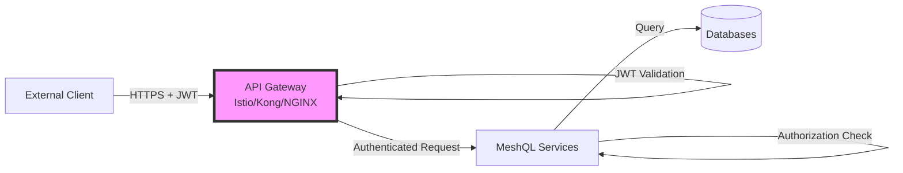
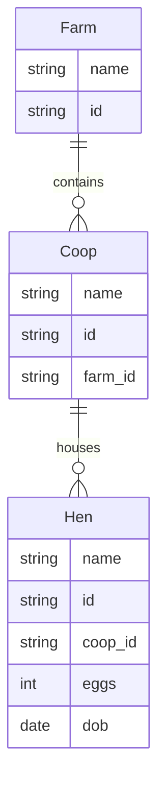

# meshobj

The TypeScript implementation of **[meshql](https://git.tildarc.com/tailoredshapes/meshql)** — and the original one.

What meshql *is* — the model, the envelope, temporal reads, honesty, how
authorization works, and the Gherkin contract every storage plugin is certified
against — is defined once in the [contract repository][contract], which this
repository runs as a git submodule at `core/cert/features/contract`. Read that
first. This README is the *how*: what is specific to running meshql on Node, and
the security model this deployment assumes.

[contract]: https://git.tildarc.com/tailoredshapes/meshql

## What is specific to TypeScript

- **The original implementation.** Where the three disagree about intent, this
  is usually where the behaviour started — the honesty fields were certified
  here first.
- **Node 20.** The workspace pins `>=20 <21`; later majors break the toolchain's
  yargs entry point.
- **Yarn workspaces driven by Lerna**, one package per component and per storage
  plugin.
- **Storage plugins**: MongoDB, PostgreSQL, MySQL, and SQLite.

### Where this implementation diverges

- **No `/<id>/versions` endpoint.** Rust exposes the version history of a
  document over REST; TypeScript does not yet. Nothing in the contract certifies
  it, which is why the gap went unnoticed.

## Security Architecture

MeshQL is designed to operate as an **internal microservice behind an API gateway** in a Kubernetes or similar container orchestration environment. Understanding this architecture is critical to evaluating its security model.

### Deployment Model



### Security Boundaries

#### 1. Authentication (API Gateway)
**Responsibility:** The API gateway is the **authentication boundary**
- Validates JWT signatures using public keys/secrets
- Checks token expiration, issuer, and audience
- Rejects invalid or expired tokens
- Only authenticated requests reach MeshQL

#### 2. Authorization (MeshQL)
**Responsibility:** MeshQL services perform **authorization decisions**
- Extract claims from pre-validated JWT tokens (using `jwt.decode()`)
- Ask the auth plugin's session about each envelope it reads
- Enforce fine-grained access control per resource

### Common Security Questions

#### "Why does JWT auth use `decode()` instead of `verify()`?"

**Answer:** This is correct for the intended architecture.

- **Gateway validates** token signatures - this is the authentication step
- **MeshQL extracts claims** from already-validated tokens - this is the authorization step
- **Benefits:**
  - No redundant cryptographic operations
  - JWT signing secrets stay at the gateway (reduced attack surface)
  - Services don't need key distribution/rotation
  - Better performance across multiple services

**When this matters:** If you deploy MeshQL as a standalone service without a gateway, you should implement JWT verification at the service level or use a proper API gateway.

#### "Are the Handlebars query templates vulnerable to SQL injection?"

**Answer:** No, this is not a SQL injection vulnerability.

- **Query templates** are defined in configuration files by administrators
- **User input** only fills template placeholders (e.g., `{{id}}`)
- Users **cannot control** the template structure itself

**Example:**
```hocon
# Configuration (admin-controlled)
query = "id = '{{id}}'"

# User provides: id = "abc123"
# Result: id = 'abc123' ✅ Safe

# User provides: id = "'; DROP TABLE users; --"
# Result: id = ''; DROP TABLE users; --' ✅ Still safe - treated as literal string
```

**Responsibility:** Administrators must write safe templates (e.g., include proper quotes). This is a configuration responsibility, not a code vulnerability - similar to writing safe Nginx configurations.

#### "Why is CORS set to `origin: '*'`?"

**Answer:** CORS is typically handled at the gateway/ingress level in production.

- The CORS configuration in MeshQL is for development convenience
- In production Kubernetes deployments, the ingress controller or service mesh handles CORS
- If deploying standalone, configure CORS appropriately for your environment

### Trust Model

MeshQL operates on a **zero-trust internal network** model:

1. **External Perimeter:** API Gateway validates all requests
2. **Internal Services:** MeshQL services trust gateway-validated tokens but make independent authorization decisions
3. **Data Layer:** Fine-grained access control via the plugin's opaque mark on each envelope

### Production Deployment Checklist

- [ ] Deploy behind an API gateway (Istio, Kong, NGINX Ingress, etc.)
- [ ] Configure gateway to validate JWT signatures
- [ ] Configure CORS at the gateway/ingress level
- [ ] Use environment-specific configuration (don't commit secrets)
- [ ] Enable audit logging for access decisions
- [ ] Implement monitoring for authorization failures
- [ ] Review your auth plugin's marking strategy for your data model

## Configuration

### 1. Domain Model

Define your domain using Mermaid class diagrams:



### 2. Storage Configuration

Configure your preferred storage backend:

```hocon
storage = {
  type = "postgres"  // or "mysql", "mongo", "sql"
  uri = "connection_string"
  collection = "collection_name"
}
```

For detailed configuration options, see the respective database plugin READMEs.

### 3. API Configuration

For detailed API configuration examples, see the [@meshql-ts/server documentation](packages/server/README.md).

## Development

### Prerequisites

- Node.js 18+
- Yarn
- Docker (for running tests)

### Setup

```bash
# Install dependencies
yarn install

# Copy example config
cp config/config.example.conf config/config.conf

# Build all packages
yarn build

# Run tests
yarn test
```

### Testing

MeshQL uses container-based testing for database integrations:

- PostgreSQL tests via testcontainers
- MySQL tests with containerized MySQL 8.0
- MongoDB tests with mongodb-memory-server
- SQLite tests with in-memory database

## API Documentation

Auto-generated OpenAPI documentation is available at `/docs` when running the server.

For detailed GraphQL documentation, visit the GraphQL playground at `/graphql`.

## License

MIT

## Author

Tom Marsh
